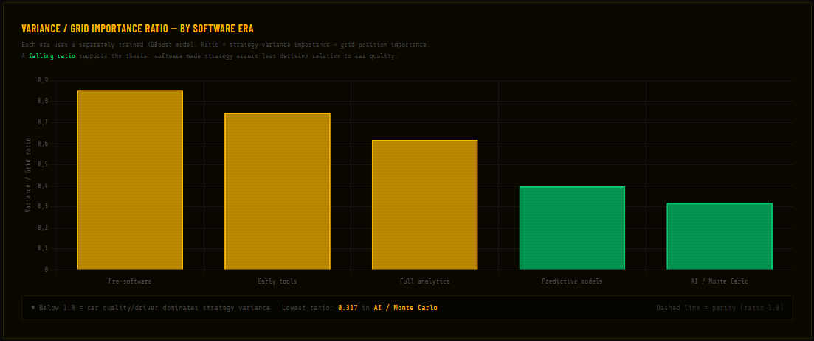
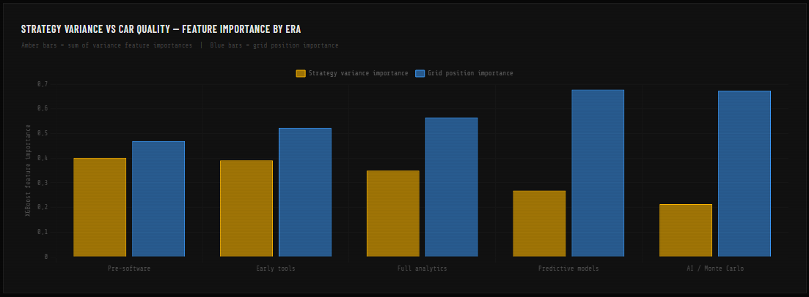
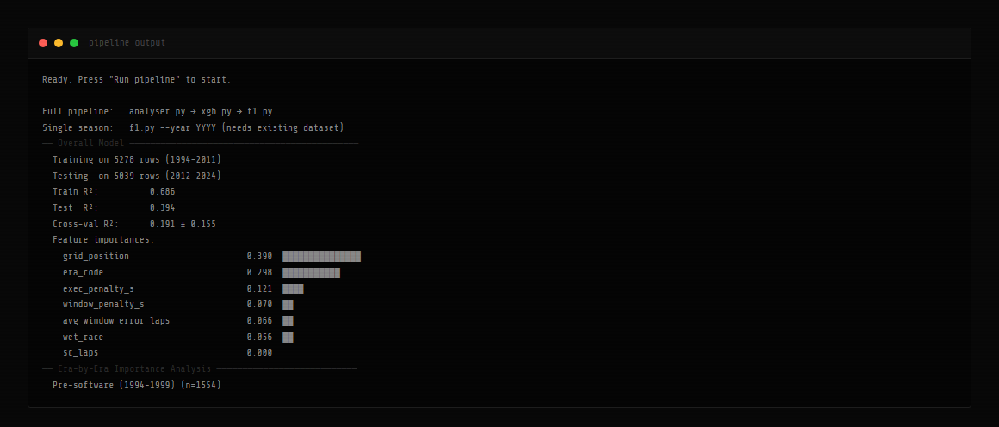

# BoxBox

An F1 strategy analysis tool that goes through 30 years of pit stops and tries to answer one question: has software made strategy mistakes matter less in Formula One?

## Background

An earlier version of this project ([`thesis-2026`](https://github.com/JUSSI-G/BoxBox/tree/thesis-2026)) was the practical part of my bachelor's thesis, *The Impact of Software Engineering on Strategy Development in Formula One* (LUT University, 2026). Since then I have kept building on it as a passion project.

In Formula One, strategic choices like pit stop timing and tyre selection have to be made within seconds, and without knowing what the other teams are going to do. Modern teams use telemetry, simulations and Monte Carlo models to support these decisions. Back in the 90s it was a lot more about intuition and experience. I wanted to see if that shift actually shows up in the race data.

## What it does

1. Computes strategy metrics for every driver in every race from 1994 to 2024 (over 10,000 driver-races)
2. Trains an XGBoost model on 1994-2011 and tests it on 2012-2024 to predict the points each driver scored
3. Trains a separate model for each software era and compares how much strategy mattered against grid position
4. Simulates every season again with a perfect pit strategy for every driver, and checks if the champion would have changed
5. Shows everything in a Flask dashboard that streams the pipeline output live

Built with Python, XGBoost, scikit-learn, pandas, Flask, Chart.js, FastF1 and the Ergast API.

## Results

### Strategy matters less in every software era



For each era I compare how important the strategy features are to the model against how important grid position is. Grid position works as the measure of car and driver quality. The ratio drops in every era, from **0.855** in 1994-1999 to **0.317** in 2018-2024, so about 63% over 30 seasons.



In practice this means strategy mistakes became less decisive and the car and the driver became more important. The biggest drop comes when moving into the predictive models era in 2012, and the ratio keeps going down in the AI and Monte Carlo era, when teams run thousands of race simulations instead of relying on single predictions.

Software is not the only reason though. Rule changes like the refuelling ban in 2010 and Pirelli becoming the only tyre supplier in 2011 also made the sport more uniform. So the results support the idea that software reduced the impact of strategy, but they don't prove it was the only cause.

### The model



The model is trained on 1994-2011 and tested on 2012-2024. I chose a split by time on purpose, so the model is always tested on seasons it has never seen. It gets a test R² of **0.39**, which is moderate. That is expected, because Formula One in 1994 and in 2024 is almost a different sport. Grid position is clearly the most important single feature.

### What if every driver had perfect strategy?

In **3 of 31 seasons** the model's champion changes when strategy errors are removed:

| Season | Champion | Champion with perfect strategy |
|---|---|---|
| 1994 | Michael Schumacher | Damon Hill |
| 2014 | Lewis Hamilton | Nico Rosberg |
| 2021 | Max Verstappen | Lewis Hamilton |

How you count the changes matters a lot here:

| Counting method | Seasons |
|---|---|
| Perfect-strategy champion is different from the real champion | 11 / 31 |
| Model gets the real champion right, and perfect strategy alone changes it | 3 / 31 |

The first way looks more dramatic, but it also counts seasons where the model already picked the wrong champion with the drivers' real strategy. In those seasons the change says more about the model than about strategy. That's why I only count the second one. The dashboard still shows the first count, and fixing that is on my to-do list.

These should be read as illustrative estimates only. The simulation removes everyone's strategy errors at the same time and keeps everything else fixed. In a real race, a better strategy from one team would make the others react, so the race would play out differently.

## How it works

The pipeline runs in three steps: `analyser.py` loads the data and computes the metrics, `xgb.py` trains the models and `f1.py` runs the championship simulation.

**Tyre degradation.** The cost of running a tyre is modelled as a quadratic function of the stint length:

```
D(p) = δ × p² / L
```

where `p` is the stint length in laps, `L` is the race length and `δ` is an era-specific degradation rate. The quadratic form means the last laps of a long stint cost much more than the first laps on fresh tyres. δ goes from 0.45 s/lap in the 90s tyre wars down to 0.20 s/lap with the 18-inch tyres from 2022.

**Strategy metrics** for every driver in every race:

- **Pit window error:** how many laps each stop was from the optimal pit lap, on average
- **Window penalty:** the same error converted into seconds with the era's degradation rate
- **Execution penalty:** the driver's average stop time compared to the fastest stop of that race, which captures things like slow tyre changes or jack failures

**Perfect strategy.** The strategy features are set to zero for every driver while grid position, era and race conditions stay the same. The model then predicts every season again and compares the champions.

## Running it

```powershell
git clone https://github.com/JUSSI-G/BoxBox.git
cd BoxBox
python -m venv venv
.\venv\Scripts\activate
pip install -r requirements.txt
```

Start the dashboard and open [http://localhost:5001](http://localhost:5001):

```powershell
python server.py
```

Or run it from the command line:

```powershell
python analyser.py --start 1994 --end 2024
python f1.py --year 2010 --dataset outputs/f1_xgb_dataset.csv
```

| Flag | Default | Description |
|---|---|---|
| `--start` | 1994 | First season |
| `--end` | 2024 | Last season |
| `--no-plot` | | Skip matplotlib plots |
| `--year` | | Single season (`f1.py` only) |

The results are saved to `outputs/`. The first full run also downloads and caches FastF1 data for 2018-2024, so it takes a while.

## Data

The datasets are included in `data/`.

| Source | What it gives |
|---|---|
| [Formula-1 Pit Stop Performance Dataset](https://www.kaggle.com/datasets/eshummalik/pitstop-pulse-formula-1-performance-data) | Pit stop timing 1994-2010 |
| [Formula 1 Pit Stop Dataset](https://www.kaggle.com/datasets/akashrane2609/formula-1-pit-stop-dataset) | Race results 1950-2024 and pit stops 2011-2024 |
| [Jolpica Ergast API](https://github.com/jolpica/jolpica-f1) | Starting grid positions |
| [FastF1](https://docs.fastf1.dev/) | Rain and safety car laps 2018-2024 |
| [f1metrics](https://web.archive.org/web/20190821033710/https://f1metrics.wordpress.com/2014/06/04/who-was-the-best-wet-weather-driver/) | Wet races 1994-2017 |

## Limitations

- The tyre degradation rates are approximations based on regulation changes and literature. Real tyre data is proprietary to the teams.
- Grid position is used as the measure of car and driver quality. It misses drivers starting from the pit lane after penalties, or cars that are better in the race than in qualifying.
- Safety car data is only available from 2018, so it has no effect on a model trained on 1994-2011.
- Before 2010 pit stops included refuelling, so the execution penalty partly reflects fuel load and not only how fast the crew was.
- The points systems are different between eras, so points are not directly comparable over the whole 30 years.

## Next up

Things I want to add next:

- Safety car data for the earlier seasons
- Normalised points so the eras can be compared directly
- A strategy simulator for a single race, where you can try different pit laps and see the result

---

MIT License, Jussi Grönroos
